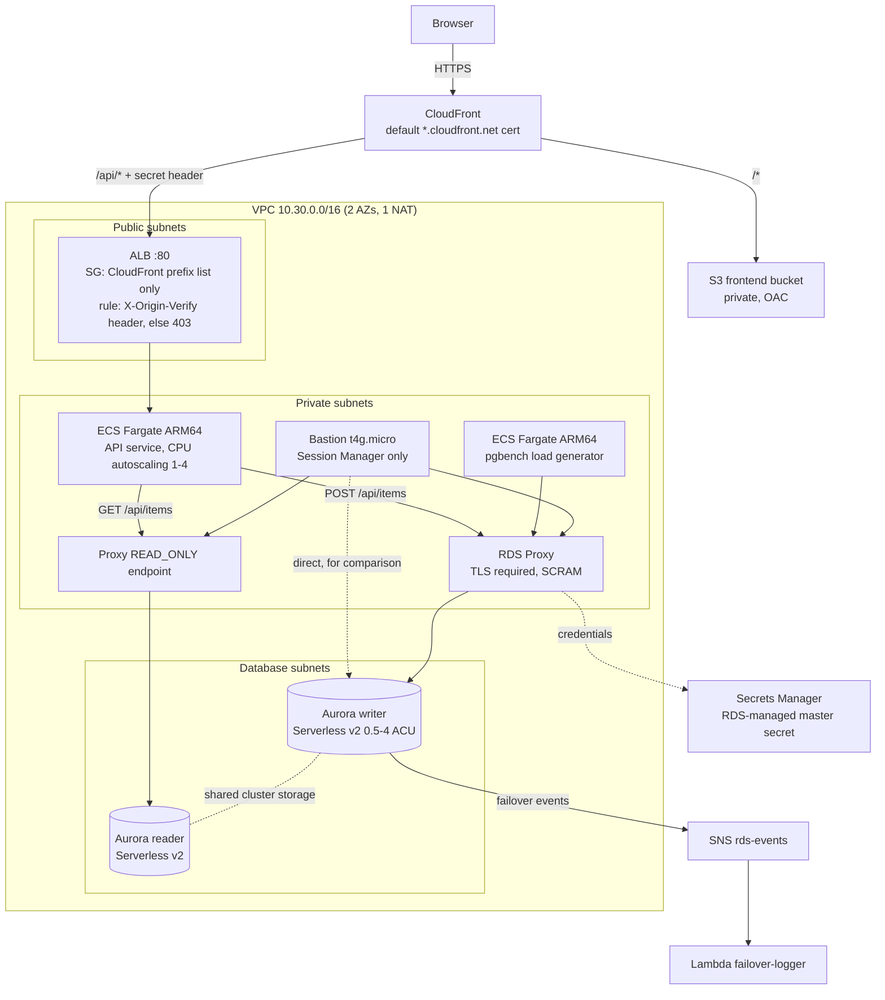

# Three-tier app on AWS: CloudFront, ECS Fargate, RDS Proxy and Aurora Serverless v2

   

A three-tier web application that shows how an application tier talks to Aurora PostgreSQL in production: connection pooling through RDS Proxy, a read/write split, failover measured through the cluster endpoint vs through the proxy, Serverless v2 scaling under load, and an edge layer where nothing is reachable except through CloudFront.

Part of a three-project series:
1. [PostgreSQL operations on RDS](https://github.com/monahgh/aws-postgres-operations)
2. **Three-tier app on ECS Fargate with Aurora and RDS Proxy** (this repo)
3. [EKS with CloudNativePG, Multi-AZ RDS and serverless](https://github.com/monahgh/aws-eks-cloudnativepg-serverless)

## What it demonstrates

| Area | What the lab covers |
|---|---|
| Connection pooling | RDS Proxy multiplexing many client connections onto few database connections; session pinning and how to measure it |
| Read/write split | Writes through the proxy's read/write endpoint (Aurora writer), reads through a READ_ONLY endpoint (Aurora reader) |
| Failover | Aurora failover measured through the cluster endpoint and through the proxy; a timeline of RDS events logged by Lambda |
| Scaling | Aurora Serverless v2 capacity under pgbench load; ECS service CPU target tracking |
| Edge security | Private S3 behind CloudFront Origin Access Control; ALB reachable only from CloudFront (prefix list + secret header) |
| Containers without builds | Public images on Fargate ARM64, application code injected at startup, secrets injected by ECS from Secrets Manager |

## Architecture



An editable diagram is in [docs/architecture.drawio](docs/architecture.drawio).

| Tier | Resources |
|---|---|
| Presentation | Private S3 bucket with `index.html` + `app.js`; CloudFront with Origin Access Control. `/*` is cached from S3; `/api/*` goes to the ALB with caching disabled and viewer headers forwarded |
| Application | ALB in public subnets; ECS cluster with Container Insights; Fargate ARM64 `api` service (Node 22) and `loadgen` service (pgbench) |
| Data | Aurora PostgreSQL Serverless v2 writer + reader (0.5-4 ACU, Performance Insights, logs to CloudWatch); RDS Proxy with a read/write and a READ_ONLY endpoint |
| Operations | SSM-only bastion with psql helpers; RDS event subscription -> SNS -> Lambda logging a JSON failover timeline |

## Design decisions

| Decision | Why |
|---|---|
| RDS Proxy in front of Aurora | Postgres connections are expensive (one process each). The proxy pools them, absorbs connection storms from autoscaling and deploys, and during failover holds client connections and routes to the new writer without waiting for DNS |
| Separate read/write and READ_ONLY proxy endpoints | Demonstrates the read/write split; reads from the reader are eventually consistent, so read-your-own-writes flows must use the writer |
| Aurora Serverless v2 | Scales in 0.5 ACU steps within seconds, cheap for a spiky lab; shared cluster storage gives faster failover than a Multi-AZ instance |
| `manage_master_user_password = true` | RDS generates and can rotate the secret; the password never appears in Terraform state. ECS injects it into tasks, and the proxy reads it through its own IAM role |
| Health check that does not touch the database | A database failover must not make the ALB drain every task (cascading failure) |
| Two locks on the public ALB | Network: the security group allows only the `com.amazonaws.global.cloudfront.origin-facing` prefix list. Application: the listener default is a fixed 403, and only requests with the secret `X-Origin-Verify` header that CloudFront adds are forwarded |
| Private S3 with OAC | The bucket policy allows `s3:GetObject` only to `cloudfront.amazonaws.com` with `AWS:SourceArn` = this distribution |
| Code injected into public images | `server.js` is base64-encoded into an environment variable and decoded at startup, so no ECR repository or build pipeline is needed for a lab |
| Separate ECS execution and task roles | The execution role pulls images, writes logs and reads the secret; the task role is what the app code may call (only ECS Exec here) |
| Autoscaling owns `desired_count` | `lifecycle { ignore_changes = [desired_count] }` stops Terraform from fighting the scaling policy |
| Deployment circuit breaker with rollback | A broken task definition rolls back instead of looping |
| Writer created before the reader | `depends_on` and promotion tiers guarantee the first instance becomes the writer |

## Repository layout

```text
terraform/   VPC (module), security groups, CloudFront + S3, ALB, ECS, Aurora, RDS Proxy, events, bastion
app/api/     Node.js items API (writer and reader pools)
app/frontend/ static single-page app
app/loadgen/ pgbench load script
lambda/      failover_logger.py (SNS -> structured JSON logs)
scripts/     bastion shell profile, failover test, frontend deploy
bootstrap/   create / delete the S3 bucket for Terraform state
docs/        architecture diagram
```

## Deploy

Prerequisites: AWS CLI v2, Terraform >= 1.10, an IAM admin profile (not root).

```bash
export AWS_PROFILE=lab

# 1. State bucket (once per account)
bash bootstrap/create_state_bucket.sh

# 2. Backend config (gitignored) and apply
cd terraform
cp backend.hcl.example backend.hcl    # set your account ID
terraform init -backend-config=backend.hcl
terraform plan -out=tfplan             # ~90 resources
terraform apply tfplan                 # ~20-25 min (Aurora, proxy and CloudFront are the slow parts)
terraform output
```

Open `app_url` in a browser. The API needs 1-2 minutes after apply to pass health checks (it installs `pg` at startup), so a 502/503 right after apply is expected.

To connect to the bastion: EC2 console -> `three-tier-lab-bastion` -> Connect -> Session Manager, then `bash -l`.

| Helper | Connects to |
|---|---|
| `use_writer` | Aurora cluster endpoint (DNS points at the current writer) |
| `use_reader` | Aurora reader endpoint |
| `use_proxy` | RDS Proxy default endpoint (read/write, writer) |
| `use_proxy_ro` | RDS Proxy READ_ONLY endpoint (reader) |

## Exercises

| # | Where / command | What to look for |
|---|---|---|
| 1 | Browser: add items, then call `/api/whoami` | Writes on the writer, reads on the reader: two different Aurora instance names |
| 2 | Bastion: `use_writer && psql -c "select aurora_db_instance_identifier(), pg_is_in_recovery()"`, then the same with `use_reader`, `use_proxy`, `use_proxy_ro` | Writer and proxy return `f`; reader and proxy_ro return `t` |
| 3 | `alb_direct_url` output | Must not work: the security group blocks non-CloudFront sources (timeout), and the listener would return 403 anyway |
| 4 | CloudWatch -> RDS -> per-proxy metrics `ClientConnections` vs `DatabaseConnections` | Many client connections (API pools, pgbench, psql) served by fewer database connections |
| 5 | CloudWatch -> `ServerlessDatabaseCapacity`, `ACUUtilization` | Capacity above 0.5 ACU under load; drops after `terraform apply -var loadgen_count=0` |
| 6 | `terraform apply -var 'loadgen_extra_flags=-M prepared'`, wait 5 minutes | `DatabaseConnectionsCurrentlySessionPinned` rises: named prepared statements pin clients to one connection. Set it back to `""` and it drops |
| 7 | Bastion: `TARGET=cluster bash /opt/dblab/scripts/failover_test.sh` | The writer swaps; the script measures write unavailability and counts `STALE` hits (DNS still pointing at the old writer) |
| 8 | ~2 minutes later: `TARGET=proxy bash /opt/dblab/scripts/failover_test.sh` | Compare with #7: the proxy tracks the writer itself, with no DNS caching |
| 9 | CloudWatch Logs Insights on `/aws/lambda/three-tier-lab-failover-logger`: `fields event_time, event_id, message \| filter type = "rds_event" \| sort event_time asc` | The failover timeline: started, completed, roles changed |
| 10 | Refresh the browser during #7 or #8 and watch `/ecs/three-tier-lab/api` logs | Brief errors on writes, reads continue; tasks are not replaced, because the health check does not depend on the database |
| 11 | Container Insights for cluster `three-tier-lab`; ECS service events | CPU per task; desired count following the 60% CPU target within 1-4 |
| 12 | Edit `app/frontend/index.html`, run `bash scripts/deploy_frontend.sh` | S3 sync and CloudFront invalidation; the change appears at the app URL |

Compare #7 and #8 with the Multi-AZ failover test in [project 1](https://github.com/monahgh/aws-postgres-operations): Aurora's writer and reader share one storage volume, so there is no block-level standby to promote.

## Production changes

- Route 53 and ACM certificates, HTTPS from CloudFront to the ALB, AWS WAF on CloudFront.
- Certificate verification to the proxy (`DB_SSL_REJECT_UNAUTHORIZED=true`).
- Security group rules that reference the source groups instead of the VPC CIDR (a lab shortcut here).
- Per-service database users instead of the master user.
- Container images built and scanned in a pipeline instead of code injected at startup.
- VPC endpoints instead of the NAT gateway, or one NAT per AZ.
- Provisioned Graviton Aurora instances for steady load (Serverless v2 is better for spiky load).

## Cost and teardown

Roughly **$0.40-0.55/hour** in eu-central-1 while running: Aurora Serverless v2 (2 x 0.5 ACU minimum), RDS Proxy (billed on a minimum of 8 ACUs for Serverless v2), NAT gateway, ALB, three small Fargate tasks and a `t4g.micro`. Run `terraform apply -var loadgen_count=0` between exercises to let Aurora scale down.

```bash
cd terraform && terraform destroy      # ~10-15 min
```

Afterwards, check that the Aurora cluster, the proxy, the CloudFront distribution and the ECS cluster are gone, and that no ENIs are left in the VPC. Delete the state bucket last with `bash bootstrap/delete_state_bucket.sh` (skip it if other projects still use the bucket).

## Troubleshooting

| Symptom | Cause | Fix |
|---|---|---|
| 502/503 right after apply | API tasks still installing `pg` or failing health checks | Wait 2 minutes; check `/ecs/three-tier-lab/api` logs |
| API logs `schema init failed ... retrying` | Proxy target not available yet | Normal for the first minutes; it retries every 5 s |
| API logs `password authentication failed` | Proxy cannot read the secret | Check the proxy role policy and RDS -> Proxies -> target health |
| API tasks keep restarting (circuit breaker rollback) | Container command failed (`npm install` needs the NAT) | Check the stopped reason in ECS -> service -> Tasks -> Stopped |
| Loadgen logs `waiting for the database...` | Proxy endpoint not ready, or a TLS/auth issue | Check proxy target health |
| `use_proxy: command not found` | Session Manager starts plain `sh` | `bash -l` |
| Destroy hangs on subnets or security groups | Fargate/proxy ENIs still detaching | Wait a few minutes and run `terraform destroy` again |
